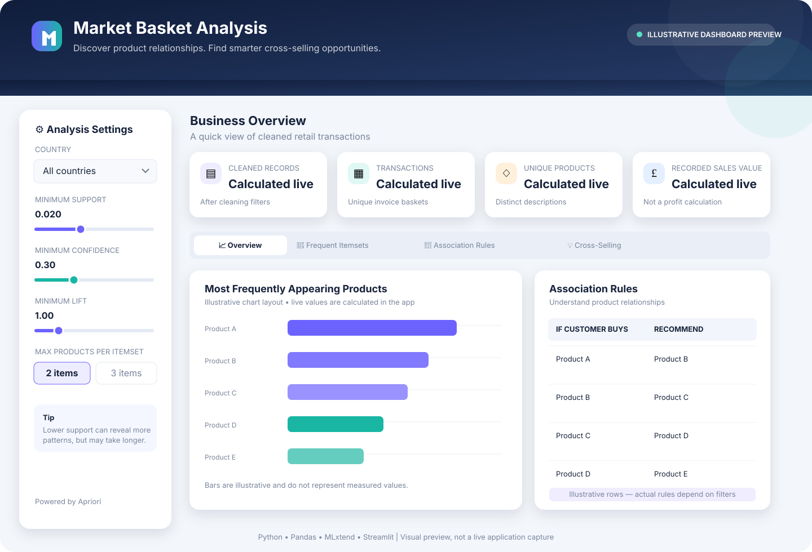

# 🛒 Market Basket Analysis

### Discover what customers buy together—and turn patterns into smarter cross-selling ideas.

<p align="center">
  <a href="https://market-basket-analysis-aboauko8fcxerqebbpwfxl.streamlit.app/">
    
  </a>
  <a href="https://github.com/rat7050/market-basket-analysis">
    
  </a>
</p>

<p align="center">
  
  
  
  
</p>

Market Basket Analysis explores which products frequently appear in the same retail transaction. Using the **Apriori algorithm** and **association rule mining**, this project finds frequent itemsets, evaluates product relationships, and surfaces potential cross-selling ideas.

It includes an interactive Streamlit dashboard, a Jupyter Notebook for exploratory analysis, and downloadable CSV results.

---

## 🌐 Live Demo

### [🚀 Launch Market Basket Analysis](https://market-basket-analysis-aboauko8fcxerqebbpwfxl.streamlit.app/)

Adjust the analysis thresholds, inspect frequent itemsets and association rules, explore product relationships, and download results for further analysis.

---

## 📸 Dashboard Preview

<p align="center">
  
</p>

<p align="center"><i>Illustrative dashboard preview, not a live application screenshot. Add a screenshot captured from the deployed app to show the actual interface and results.</i></p>

**To add a real screenshot:** Open the live demo, capture the page you want to showcase, save the image as `assets/dashboard-screenshot.png`, and add this below the preview:

```markdown

```

---

## 🎯 Business Problem

Retailers often want to know which products tend to be purchased in the same order. These patterns can inspire product bundles, related-item recommendations, promotion ideas, and merchandising experiments.

This project helps explore questions such as:

- Which items or combinations frequently appear in the same basket?
- When a basket contains one item, what other items are associated with it?
- How frequent is a combination, and how strong is its association?
- Which relationships might be worth testing as cross-selling opportunities?

Association rules describe patterns in observed transactions. They do **not** prove that one product causes another to be purchased.

## ✨ Key Features

- **Retail data cleaning** — excludes cancelled invoices, missing values, invalid purchase lines, and duplicate rows.
- **Interactive Streamlit dashboard** — explore the results across four tabs.
- **Country filtering** — analyse a selected country or all available countries.
- **Adjustable thresholds** — configure minimum support, confidence, and lift.
- **Frequent itemsets** — discover combinations that appear together across baskets.
- **Association rules** — inspect antecedents, consequents, support, confidence, and lift.
- **Visual analytics** — view top products, transactions by country, frequent combinations, and rule relationships.
- **Cross-selling suggestions** — explore product recommendations ranked by association strength.
- **CSV downloads** — export frequent itemsets, association rules, and recommendations.
- **Jupyter Notebook** — follow the exploratory workflow and learn how the analysis is performed.

## 🧭 How It Works

```text
Online Retail Transactions
           │
           ▼
   Data Cleaning & Filtering
           │
           ▼
   Group Products by Invoice
           │
           ▼
     Basket / Item Matrix
           │
           ▼
    Apriori Frequent Itemsets
           │
           ▼
       Association Rules
           │
           ▼
  Support • Confidence • Lift
           │
           ▼
 Streamlit Dashboard & CSV Exports
           │
           ▼
   Cross-Selling Ideas to Test
```

## 📊 Dataset

This project uses the **Online Retail** dataset from the UCI Machine Learning Repository.

- **Official dataset:** [UCI Online Retail](https://archive.ics.uci.edu/dataset/352/online+retail)
- **File:** `data/Online Retail.xlsx`
- **Period covered:** December 2010 to December 2011
- **Domain:** Online retail transactions

The data includes invoice numbers, product descriptions, quantities, unit prices, and country. The basket analysis works with cleaned purchase lines and counts each distinct product once per invoice.

**Dataset citation:** Chen, D. (2012). *Online Retail* [Dataset]. UCI Machine Learning Repository. https://doi.org/10.24432/C5BW33

## 📐 Understanding the Metrics

| Metric | What it measures | How to interpret it |
|---|---|---|
| **Support** | Fraction of baskets containing an itemset | Higher support means the combination appears more frequently. |
| **Confidence** | Fraction of baskets containing the antecedent that also contain the consequent | Higher confidence means the rule occurs more often within baskets containing the antecedent. |
| **Lift** | Confidence divided by the consequent's overall support | Lift greater than 1 indicates a positive association; near 1 indicates little association; below 1 indicates a negative association. |

For a rule `A → B`, confidence describes how often B appears among baskets that contain A. It does not establish that buying A causes someone to buy B.

## 🧰 Tech Stack

| Tool | Purpose |
|---|---|
| Python | Core project implementation |
| Pandas | Data cleaning, transformation, and tabular analysis |
| NumPy | Numerical operations |
| MLxtend | Apriori and association rule mining |
| Streamlit | Interactive application |
| Matplotlib & Seaborn | Data visualisation |
| Jupyter Notebook | Exploratory analysis |
| OpenPyXL | Reading the Excel dataset |

## 📁 Project Structure

```text
market-basket-analysis/
├── app.py
├── market_basket_analysis.ipynb
├── cross_selling_recommendations.csv
├── requirements.txt
├── README.md
├── assets/
│   └── dashboard-preview.svg
└── data/
    └── Online Retail.xlsx
```

## 💻 Run Locally

### 1. Clone the repository

```bash
git clone https://github.com/rat7050/market-basket-analysis.git
cd market-basket-analysis
```

### 2. Create and activate a virtual environment

**Windows PowerShell**

```powershell
py -m venv .venv
.\.venv\Scripts\Activate.ps1
```

**macOS / Linux**

```bash
python3 -m venv .venv
source .venv/bin/activate
```

### 3. Install dependencies

```bash
python -m pip install --upgrade pip
pip install -r requirements.txt
```

### 4. Check the dataset

Confirm that the Excel file is available at `data/Online Retail.xlsx`. It is included in this repository. If you need a fresh copy, download it from the [official UCI dataset page](https://archive.ics.uci.edu/dataset/352/online+retail).

### 5. Run the dashboard

```bash
streamlit run app.py
```

Open the local URL printed by Streamlit, typically `http://localhost:8501`.

### 6. Run the notebook

```bash
jupyter notebook
```

Open `market_basket_analysis.ipynb` and run the cells from top to bottom.

## 🔎 Using the Dashboard

1. Open the [live dashboard](https://market-basket-analysis-aboauko8fcxerqebbpwfxl.streamlit.app/) or start it locally.
2. Select a country or keep **All countries** selected.
3. Adjust minimum support, confidence, lift, and maximum itemset size in the sidebar.
4. Review the **Overview** tab for top products and country-level transaction patterns.
5. Explore **Frequent Itemsets** to find common combinations.
6. Open **Association Rules** to compare support, confidence, and lift.
7. Use **Cross-Selling** to review potential related-product suggestions.
8. Download the CSV files for further analysis.

Lower support thresholds may find more combinations but can increase computation time and surface less frequent patterns. Increase the thresholds to focus on stronger or more common associations.

## 💼 Potential Business Applications

- **Product recommendations:** display relevant related items on product pages.
- **Bundle experiments:** test bundles containing products that often appear together.
- **Merchandising:** investigate whether associated products should be displayed nearby.
- **Promotion planning:** develop hypotheses for targeted campaigns.
- **Inventory coordination:** check stock levels before promoting associated items.

These are ideas to validate through controlled tests and business metrics. Association metrics alone do not guarantee increased sales or profit.

## ⚠️ Data & Methodology Notes

- Invoice numbers beginning with `C` are treated as cancellations and excluded.
- Rows with missing invoice numbers, descriptions, quantities, or unit prices are removed.
- Non-positive quantities and unit prices are excluded.
- Duplicate rows are removed.
- Each product is counted once per invoice for basket presence; quantity does not multiply product presence.
- Apriori can be slow with low support thresholds or many unique products. Start with a sensible value such as 0.02 and adjust carefully.
- Recorded sales value is not the same as profit.
- Association does not prove causation.

## 🚀 Future Improvements

- Add date-range and product-level filters.
- Compare associations across customer segments and time periods.
- Validate recommendations using experiments and actual sales/profit outcomes.
- Add product search to find rules involving a selected item.
- Improve performance for larger transaction datasets.
- Add repeatable automated tests and continuous integration.
- Add screenshots captured directly from the deployed app.

## 👨‍💻 Author

**Ratnesh Kumar**

- **GitHub:** [@rat7050](https://github.com/rat7050)
- **Repository:** [Market Basket Analysis](https://github.com/rat7050/market-basket-analysis)
- **Live Demo:** [Open Streamlit Dashboard](https://market-basket-analysis-aboauko8fcxerqebbpwfxl.streamlit.app/)

---

<p align="center"><b>Built with Python, Pandas, MLxtend, and Streamlit.</b></p>
